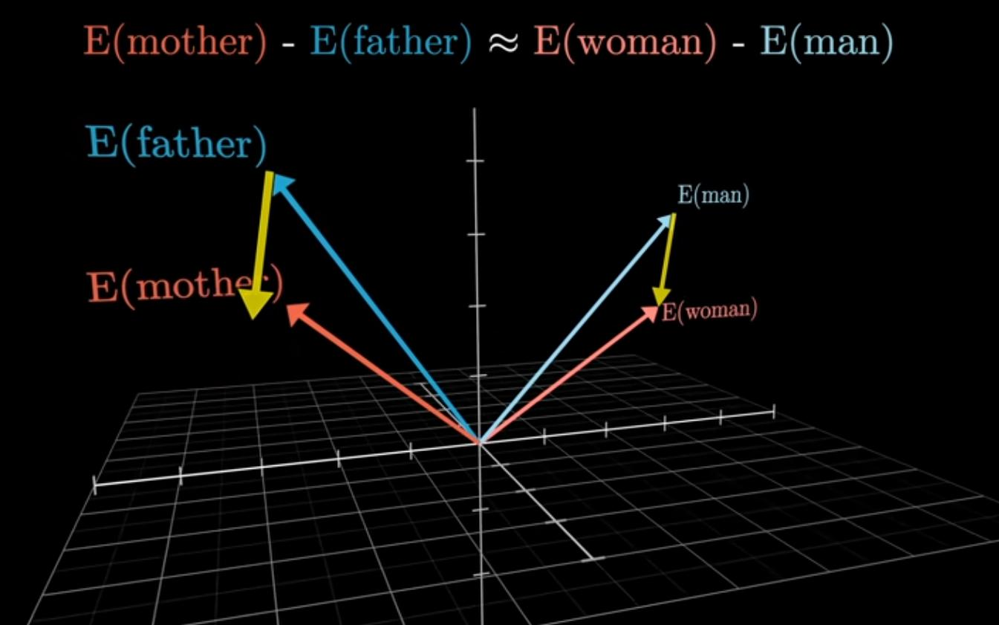
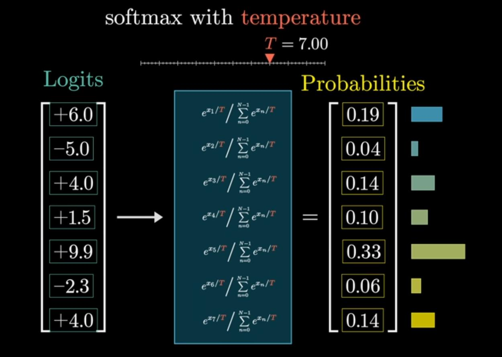
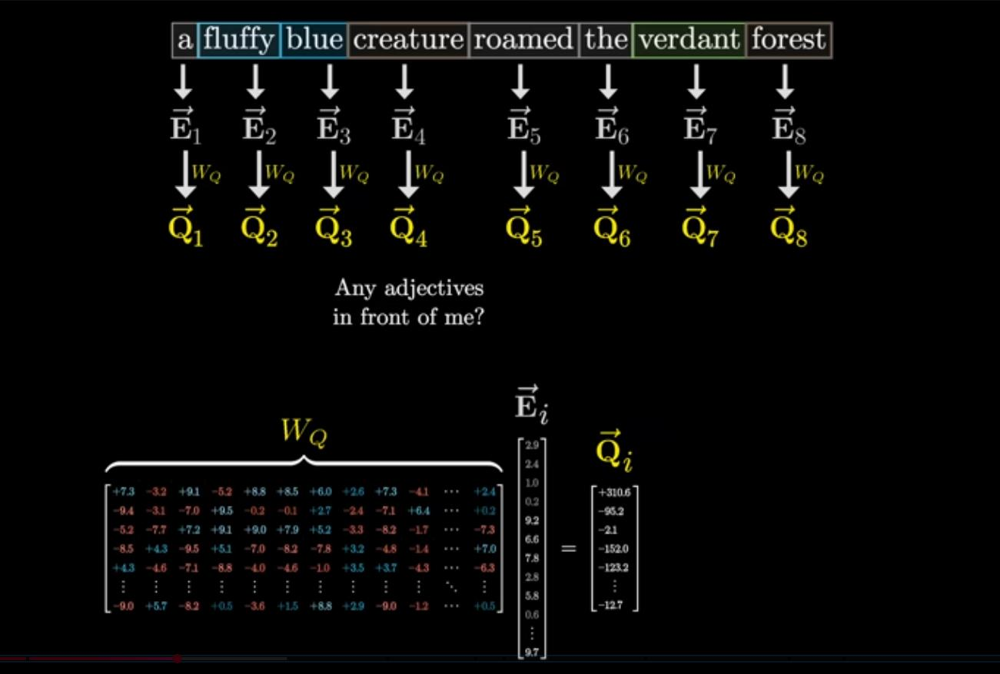
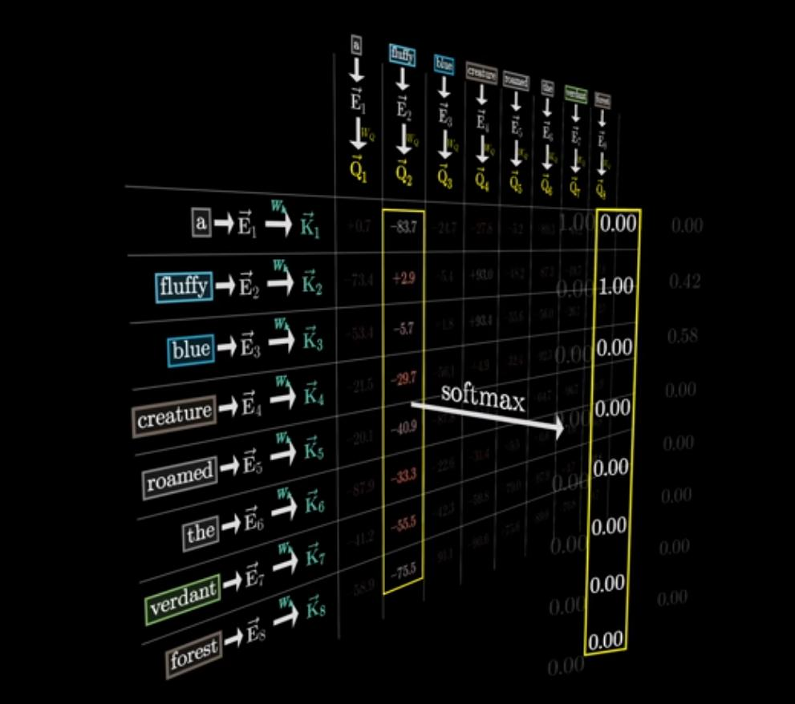
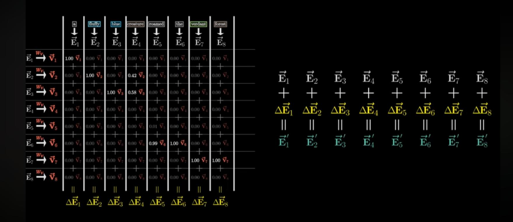
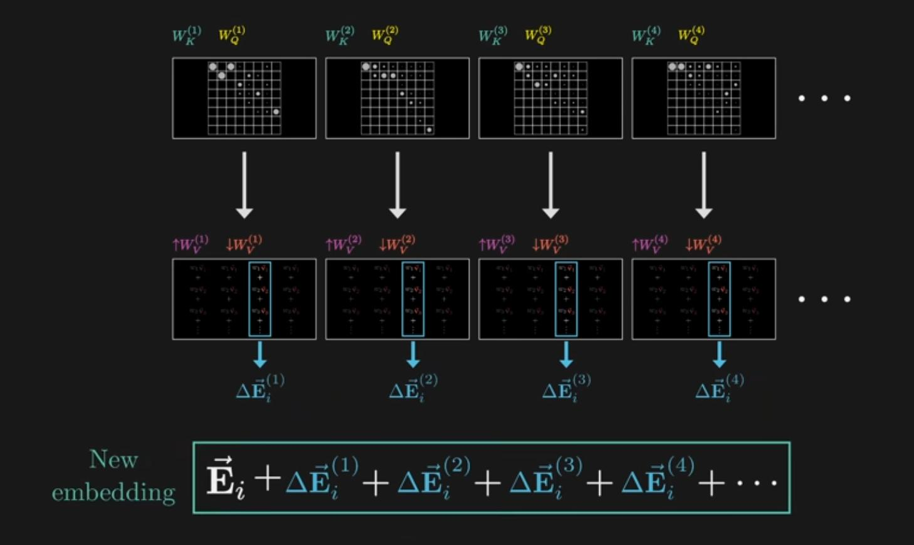
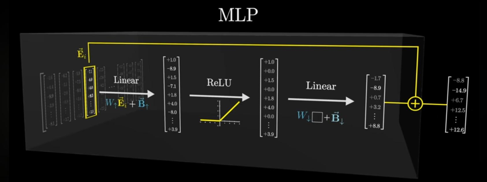

# LLM

From: 3Blue1Brown's [Nueral networks playlist](https://youtube.com/playlist?list=PLZHQObOWTQDNU6R1_67000Dx_ZCJB-3pi)

## Before Tranfromers

- The modal gives us a propability vector for possible next token for a given string
- We dont always choose the highest probability

```
ITER 1: inputs -> word1
ITER 2: inputs + word1 -> word2
ITER 3: inputs + word1 + word2 -> word3

so on, till we get a complete response.
```

- Before Transformers, This computation was sequential, very very long.
- Tranformers (from Google in 2017) introduced parrallel computation for this.
- Paper was titled "All you need is Attension"
- Traning is splited
    1. Pretraining, Traninig on huge unlabelled text from internet.
    2. RLHF, Reinforcement learning with human feedback

## Transformers

### Working

Tranformer works in the following way,

1. Input token are converted into vector embeddings
    - Token are common pieces of words, chunks of pixels, chucks of sound.
    - Token is associated with numeric Vectors, such that similar meaning vectors are close.
2. Attension step
    - Vector's meaning is altered depending on all other input vectors in context
    - Like meaning of model in "data science modal" vs "fashion model" are different
3. Feedforward multilayered perceptron
    - The nueral network with weights & biases
4. Both of these are repeated several times
    - This attension + perceptron combined form a `Tranformer Layer` or `Tranformer Block`
    - Attension stores "Logic" while MLP stores "Facts" loosely.
5. Output token
    - Each vector how holds probability for next token
    - Hence last vector now holds meaning of output token
    - Used to get a probability distribution of all output tokens

After getting a output token, We append it to the input tokens and whole process is repeated.  

**NOTE**: `Tensors`, means scalers, vectors or matrics of higher dimensions

### Embedding

- Models have predefined vocabulary of tokens (50k)
- Embedding matrix has a column for each token
- This embedding matrix, is part of model's Weights
- This is used to map tokens to vectors, called `Embedding`
- Initially this is set at random

Each dimension in vector, would "hold some meaning" like "gender

```
E(man) - E(woman) + E(uncle) -> E(aunt)
OR
E(hitler) + E(Italy) - E(Germany) -> E(Mussoilini) 
```

- Note that there are losely similar, not extactly.
- These vectors are of high dimensions like (GPT3 12,288), called `Embedding dimensions`



### Decoding / Inserve Embedding Projection

- In final layer, each vector simultaneously predicts next word
- Unembedding Matrix has a row for each token, column for each embedding dimesion
- Its order is reversal of embedding matrix.
- This unembedding matrix is used to get `Logits`

```
Logits = Unembedding matrix * Last vector
Logits -> Softmax -> Probability distribution for each token
```

- Softmax converts any sequence of numbers to valid (+ve and sum is one) distribution.
- softmax is used to normalise the logits into probability distribution
- We can add a `Temperature` to this softmax, where
    - More temperature -> more uniform
    - Less temperature -> more peaks in distribution
- inputs for softmax are called `Logits`



### Attension

- For any token, embedding vector's meaning doesnot depend on context of all other tokens
- The input for this are matrix of vectors which stand for
    1. Embedding vector
    2. Position of the vector in the context

#### Single `Head` of Attension 

1. Compute Query & Key
    - Embedding is multipled by a Weight matrix (Wq) to get a `Query`.
    - Embedding is mutiplied by another Weight matrix (Wk) to get a `Key`
    - Query & key are small dimensional vectors (like 128)



2. Match Queries with Keys
    - Compute dot product of each key with all queries
    - If product is high, we say a key `attends to` a query
    - We then pass all dot products from a query into softmax
    - Now obtained grid is called `Attension Pattern`



3. Updating Embeddings
    - Embedding is multipled by another Weight Matrix (Wv) to get a `value`
    - then compute change in embedding by weighted sum of value vector and attension value

```
ΔEi = Weighted sum( ith column from attension grid, Value vector matrix)
```



**NOTE** Since size of Attension pattern is square of context size, this turn
out to be a major bottleneck for context window size.  

**NOTE** During training, we compute prediction from all vectors in the final
matrix instead of only the last vector, That gets us many training examples at
once instead of just one. For this to happen, we cannot let key from a token 
"attend to" to query from another token appearing before it. As that would give
away the answer, so during training we set diagonally half of attension matrix
to -inf and then normalise to make them 0. This is called `Masking`.

#### Self attension vs Cross attension

Cross attension are in models involved with 2 different types of data.
- Ex: translation models, audio to text, text to speech 
- Key and Query mapps acts on different data sets
- For translation models, Attension pattern may associate words in one lanuage with other.
- Masking is never present.

#### Multi-Headed Attension

- In actuality, we use many n number of attension pattern at once.
- This n is called n heads
- That means n different, query, key & value weight matrices.
- In GPTv3, there are 96 heads and then again 96 Transformer layers



### Multi Layered Perceptron

- This has the same Nueron say studied earlier
- Each nueron has Weight matrix and Bias vector
- Often GELU (Gausian Error Linear Unit) is used instead of ReLU



### Chatbots

LLMs are then converted to Chatbots formatting inputs token like these.

```
System Prompt

User: User prompt
Assistant: ___
```


