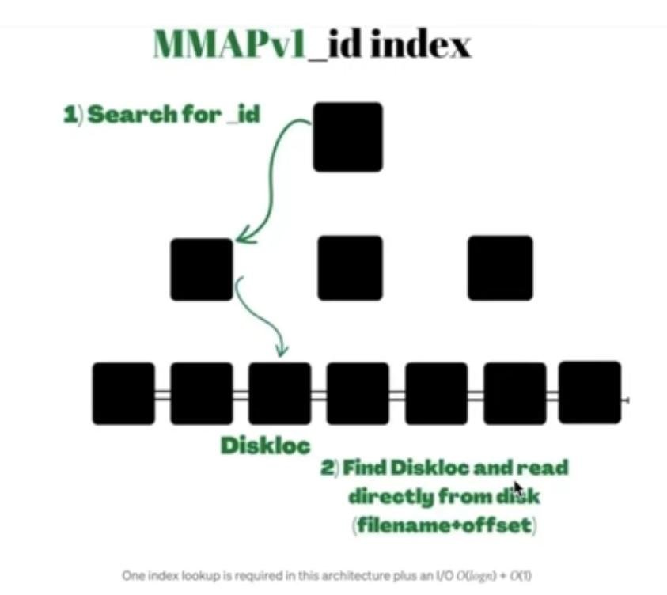

# MongoDB

Document oriented NoSQL Database  
Every database consists of

1. Frontend
    - API
    - Data format
2. Storage Engine
    - Storage
    - Indexes
    - Data files
    - Transactions
    - WAL

## Storage Engine

- Objective is efficiency of page reads and writes.
- Storage engine treats Data as bytes anyways.
- the SQL vs NoSQL difference mostly lies in Frontend, 
- The frontend can then be made on top by treating data as graphs, tables, documents etc
- Example: RocksDB, LevelDB

### Working of MongoDB's storage engine.

- ObjectId generated  by default is 12 bytes, and includes timestamps to make it globally unique.
- _id itself can almost accept any valid BJSON data type.
- Page size of WiredTiger is 32KB
- Maximum size of BSON documents in 16MB.

#### Version 1, MMAPv1

- Diskloc is 64Bits, containing filename + offset
- One index lookup gets you the document location
- Modification in file, scrambled offset for entire file.
- Had a global write lock, 2 concurrent writes in different collections npt allowed.

```
_id -> Diskloc -> Page
```



#### Version 2

- Had collection level locks

#### Version 3, WiredTiger

- WiredTiger is aquired and used a the storage engine.
- Has document level locks, similar to row level locking in most DBs (Postgres, MySQL - InnoDB)
- Introduced document compression.

- Uses `clustered B-tree` leaf nodes contain the data itself

```
_id -> recordid -> document
```


#### Version latest, Clustered collection

- For clustered collections, _id becomes key for the clustered B-tree directly.
- But now secoundry indexs map to _id, which itself is bloated

### How writing work?

- There is not writing a single byte, always in page. (Sector in HDD)
- because no Byte addresibility in disk.
- a Page that is changed is called `dirty page`.
- These changes are collected and  flushed at once.
- Since changes are collected, We need to write `WAL` to disk for crash tolerance.
- Writing to WAL is called `journaling` in Mongo
